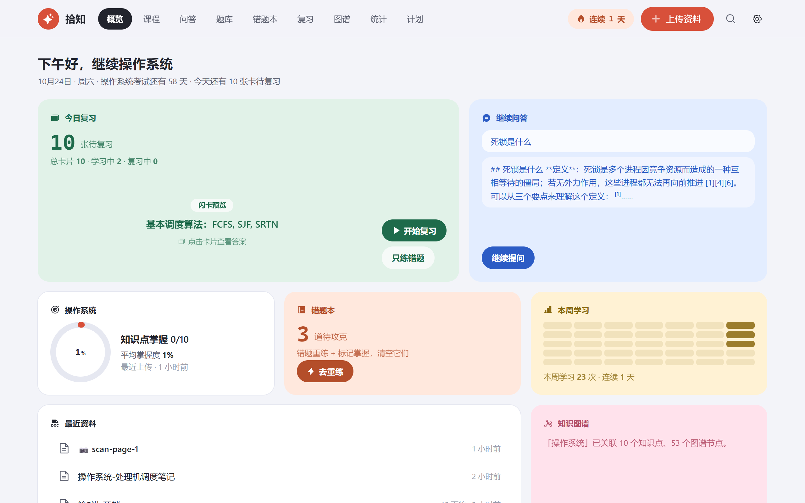
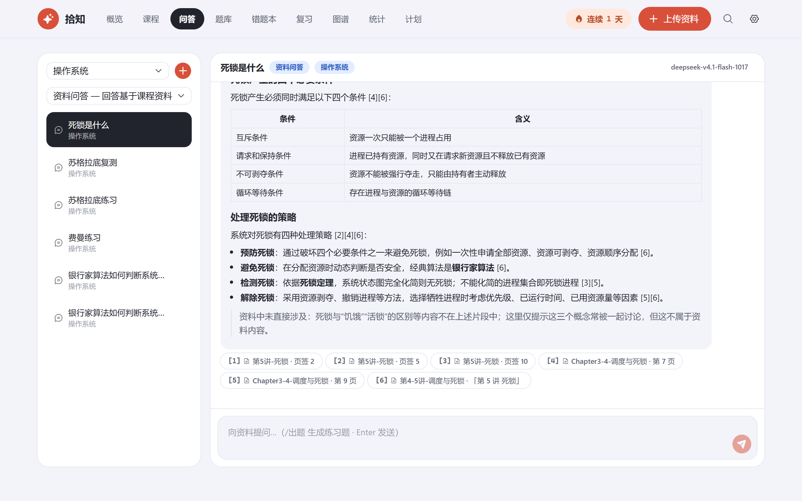
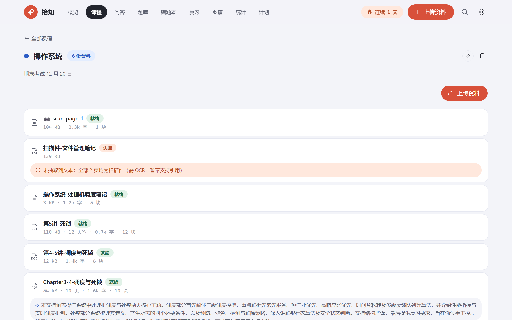
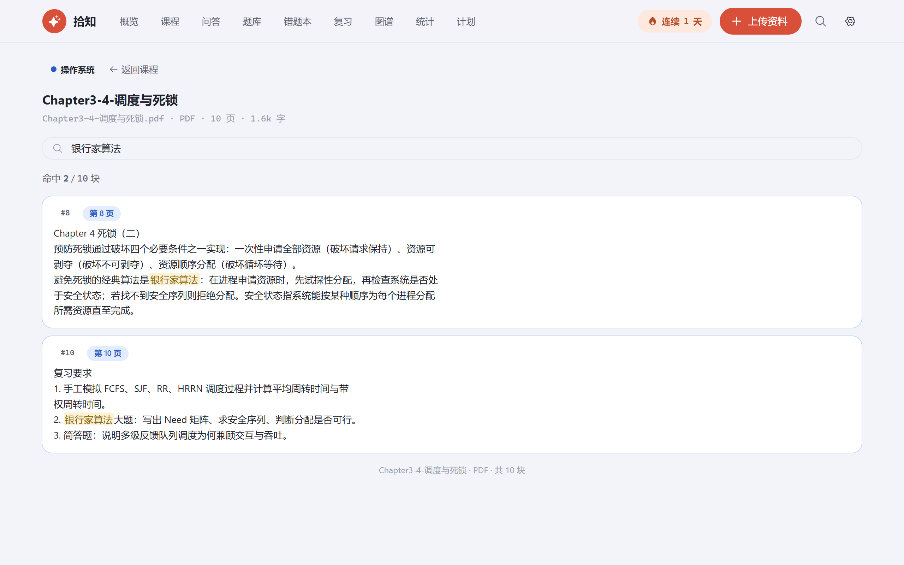
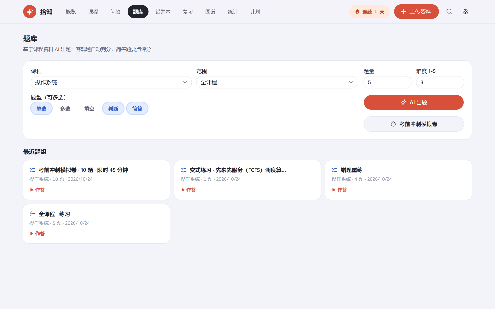
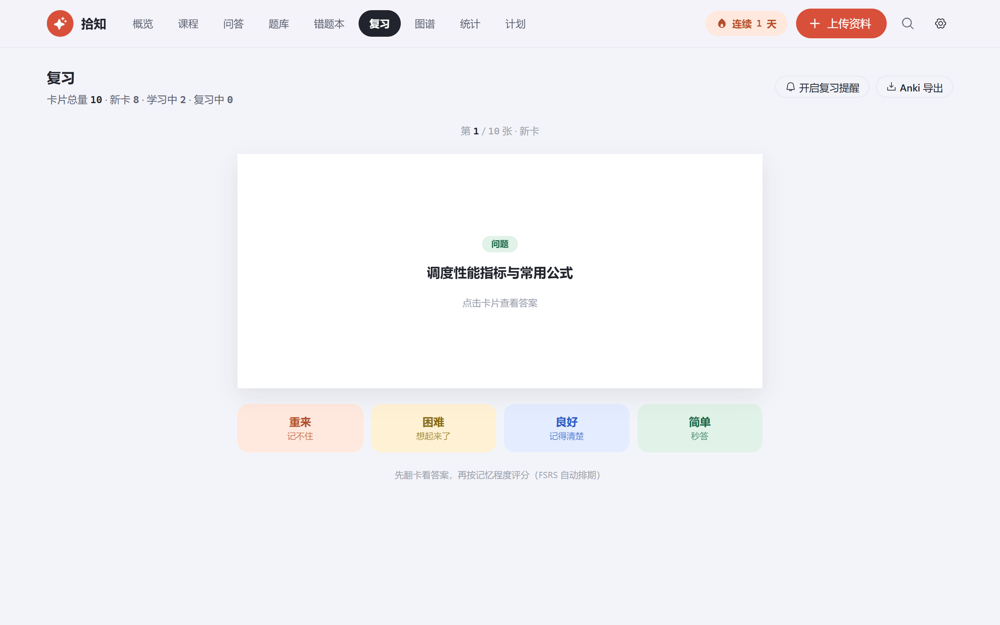
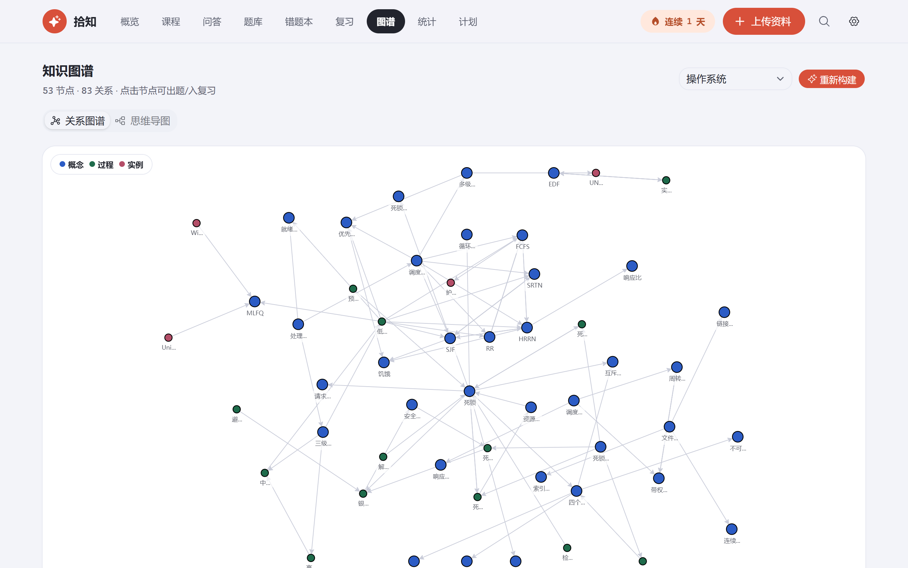
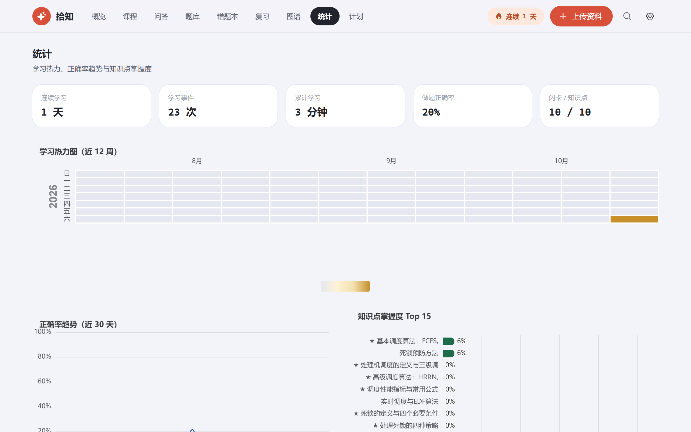

# 拾知

本地运行的 AI 学习助手。上传课程资料，之后的一切围绕这些资料展开：提问、出题、错题、复习、统计，全部在浏览器里完成，数据存在本机一个 SQLite 文件里，不联网上传，没有账号。

## 它能做什么

- **资料入库**：PDF / Word / PPT / Markdown / TXT 拖进去，自动解析分块、生成摘要和知识点。扫描件 PDF 会标记出无法引用的页；拍照或截图走视觉模型 OCR 识别后同样入库。
- **资料问答**：基于检索到的内容回答，句末带 `[n]` 角标，点来源芯片能定位到原文所在的页码、页签或标题。公式用 LaTeX 渲染。另有费曼模式（你讲解、AI 挑错）和苏格拉底模式（AI 只提问、不给答案）。
- **出题练习**：单选、多选、填空、判断、简答五种题型，可按全课程、单个文档或单个知识点出题。客观题自动判分，简答题按要点给分并附反馈。答错的题进错题本，可以重练、生成变式题，考前还能组一张限时模拟卷。
- **间隔重复**：知识点一键转闪卡，按 FSRS 算法排期，翻卡后按记忆程度评分。支持浏览器通知提醒和 Anki CSV 导出。
- **知识图谱**：AI 从知识点和资料里抽实体与关系，力导向布局展示，点节点可以直接围绕它出题或转入复习；同一页还有按知识点展开的思维导图。
- **统计与计划**：学习热力图、正确率趋势、知识点掌握度；填一个考试日期，AI 结合薄弱点倒排出每天的复习任务清单。
- **笔记**：Markdown 编辑，`[[知识点名]]` 互链到课程知识点，可导出 MD 或 Word。

## 截图

| 概览 | 资料问答 |
|---|---|
|  |  |

| 课程与知识点 | 文档内检索 |
|---|---|
|  |  |

| 练习与判分 | 闪卡复习 |
|---|---|
|  |  |

| 知识图谱 | 学习统计 |
|---|---|
|  |  |

## 运行

要求 Node.js 20.9+（开发环境为 Node 24），npm。

```bash
npm install
npm run dev
```

打开 http://localhost:3000。

### 配置模型

在「设置」页填一个 OpenAI 兼容接口即可，默认为 [Agnes](https://agnes-ai.cn)（`https://api.agnes-ai.cn/v1` + `agnes-3.0-flash`，需自建 API Key）。也可以在 `.env.local` 里写：

```
AGNES_API_KEY=sk-...
```

三个槽位各自独立可配：对话模型（问答、出题、评分、计划）、视觉模型（OCR，默认跟随对话模型）、Embedding（可选，默认关闭，检索走自研 BM25 中文分词；配置后启用向量 + RRF 混合检索）。每项都有测试连接按钮。

## 数据都在哪

- `data/shizhi.db` —— 全部数据（SQLite 单文件）
- `data/uploads/` —— 上传的原始文件

两个目录都不进 git。想清空重来，删掉 `data/` 目录即可。

## 技术栈

Next.js 16（App Router）+ TypeScript + Tailwind CSS 4 + shadcn/ui；SQLite + Drizzle ORM；GSAP 动效；KaTeX 公式；ts-fsrs 间隔重复；AntV G6 图谱；ECharts 统计图；markmap 思维导图；unpdf / mammoth / officeparser 文档解析。

## 其他

- 单元测试：`npm test`
- 生产构建：`npm run build && npm start`
- 首次使用：建课程 → 上传资料 → 等「就绪」后点 AI 加工生成知识点 → 之后问答、出题、转闪卡都可以用了
